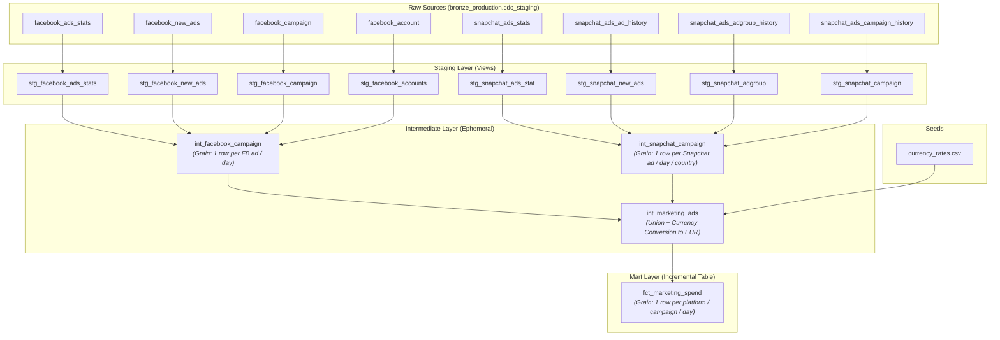

# Marketing Data Warehouse (dbt + Databricks)

A modular, production-ready dbt project for ingesting, transforming, and unifying cross-platform marketing performance data (**Facebook Ads** and **Snapchat Ads**) into an analytics-ready fact mart on **Databricks Unity Catalog**.

---

## 🏗 Architecture & Data Lineage



---

## 📁 Project Structure

```text
cde_marketing_project/
├── pyproject.toml                # Python dependencies (dbt-databricks, elementary-data)
├── uv.lock                       # uv lockfile
├── cde_marketing/
│   ├── dbt_project.yml           # Project configurations & model materializations
│   ├── packages.yml              # dbt dependencies (dbt_utils, elementary, dbt_expectations)
│   ├── profiles.yml              # Databricks Unity Catalog connection profile
│   ├── models/
│   │   ├── staging/
│   │   │   ├── _staging.yml      # Schema definitions, documentation & tests
│   │   │   ├── facebook/
│   │   │   │   ├── _facebook__sources.yml
│   │   │   │   ├── stg_facebook_accounts.sql
│   │   │   │   ├── stg_facebook_ads_stats.sql
│   │   │   │   ├── stg_facebook_campaign.sql
│   │   │   │   └── stg_facebook_new_ads.sql
│   │   │   └── snapshat/
│   │   │       ├── _snapchat_sources.yml
│   │   │       ├── stg_snapchat_adgroup.sql
│   │   │       ├── stg_snapchat_ads_stat.sql
│   │   │       ├── stg_snapchat_campaign.sql
│   │   │       └── stg_snapchat_new_ads.sql
│   │   ├── intermediate/
│   │   │   ├── int_facebook_campaign.sql # Ad-level daily performance for Facebook
│   │   │   ├── int_snapchat_campaign.sql # Ad-level daily performance for Snapchat
│   │   │   └── int_marketing_ads.sql     # Unified multi-platform ad performance in EUR
│   │   └── mart/
│   │       └── fct_marketing_spend.sql   # Daily campaign-level spend & performance mart
│   ├── seeds/
│   │   ├── _seed.yml             # Seed documentation & tests
│   │   └── currency_rates.csv    # Static currency conversion rates to EUR
│   └── tests/
│       └── .env.template         # Environment variables template
```

---

## 📐 Data Modeling Layers

### 1. Staging Layer (`models/staging/`)
- **Purpose**: 1-to-1 reflection of raw source tables.
- **Operations**:
  - Cleans and standardizes column naming (e.g. `ad_id`, `report_date`, `spend`, `impressions`, `clicks`).
  - Casts data types safely using `try_cast` to handle raw malformed values (such as `'null'` strings).
  - Deduplicates history tables using `qualify row_number() over (partition by <id> order by updated_at desc) = 1` to ensure only the latest dimension state is preserved.

### 2. Intermediate Layer (`models/intermediate/`)
- **Purpose**: Complex joins, entity stitching, and standardization.
- **Models**:
  - `int_facebook_campaign`: Traverses `ad -> campaign` & `account` dimensions with `LEFT JOIN`s so no spend is dropped.
  - `int_snapchat_campaign`: Traverses `ad -> ad_group -> campaign` hierarchy.
  - `int_marketing_ads`: Unions both platforms into a unified schema, generates a unique surrogate key (`ad_performance_key`), and applies currency conversion rates (`spend_eur = spend * rate_to_eur`).

### 3. Mart Layer (`models/mart/`)
- **Purpose**: Business-facing aggregation for analytics and BI.
- **Model**: `fct_marketing_spend`
  - **Grain**: 1 row per `date`, `platform`, `campaign`.
  - **Strategy**: Incremental table using `merge` on `['date', 'platform', 'campaign']`.
  - **Lookback Window**: Recomputes the last `lookback_days` (default `3` days) on each run via `var('lookback_days', 3)` to capture late-arriving and restated platform metrics.

---

## ⚙️ Setup & Installation

### 1. Environment Requirements
- Python `>= 3.11`
- [`uv`](https://docs.astral.sh/uv/) (recommended) or `pip`

Install dependencies:
```bash
uv sync
```
*(Or `pip install -r pyproject.toml`)*

### 2. Configure Environment Variables
Copy the template and set your Databricks credentials:
```bash
cp cde_marketing/tests/.env.template .env
```

Required variables:
```bash
export DATABRICKS_PAT_TOKEN="<your-databricks-personal-access-token>"
export DEV_HTTP_PATH="<your-databricks-sql-warehouse-http-path>"
export DEV_CATALOG="bronze_production"
export DEV_SCHEMA="cdc_staging"

# Optional overrides:
export BRONZE_CATALOG="bronze_production"
export BRONZE_SCHEMA="cdc_staging"
```

Activate the environment variables:
```bash
source .env
```

---

## 🚀 Running the Project

Navigate into the dbt project folder:
```bash
cd cde_marketing
```

### 1. Install dbt Packages
```bash
dbt deps
```

### 2. Load Seeds (Currency Rates)
```bash
dbt seed
```

### 3. Build Models & Run Tests
Run the entire pipeline (builds seeds, models, and executes tests):
```bash
dbt build
```

Or run targeted commands:
```bash
# Run only staging models
dbt run --select staging

# Run intermediate and marts
dbt run --select intermediate+

# Full refresh of incremental models
dbt run --select fct_marketing_spend --full-refresh

# Run tests
dbt test
```

---

## 🧪 Data Quality & Observability

- **Built-in & dbt-utils tests**:
  - `unique` and `not_null` constraints on primary keys (`ad_id`, `campaign_id`, `ad_group_id`, `account_id`).
  - `dbt_utils.unique_combination_of_columns` to ensure grain uniqueness.
  - `dbt_utils.accepted_range` ensuring non-negative metrics (`spend >= 0`, `impressions >= 0`, `clicks >= 0`).
  - `accepted_values` for currency codes (`['EUR', 'USD']`).
- **Elementary Data Observability**:
  - Monitored by the `elementary` package for automated anomaly detection, schema change tracking, and test reporting.
** Screenshots of Elementary, Dbt docs and databricks view


